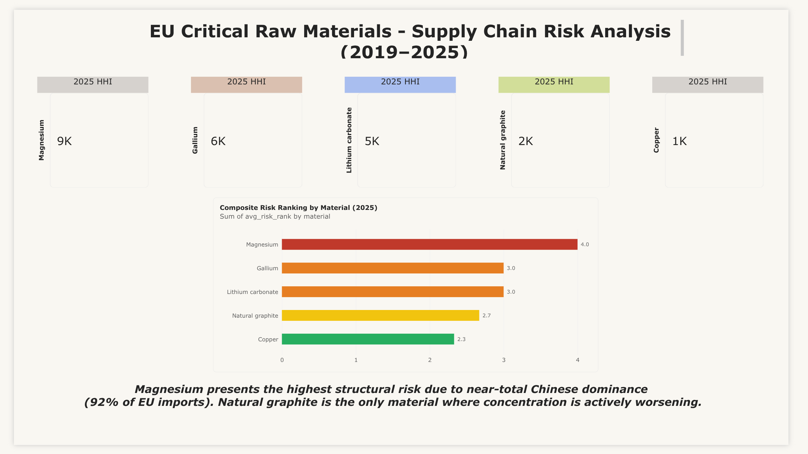
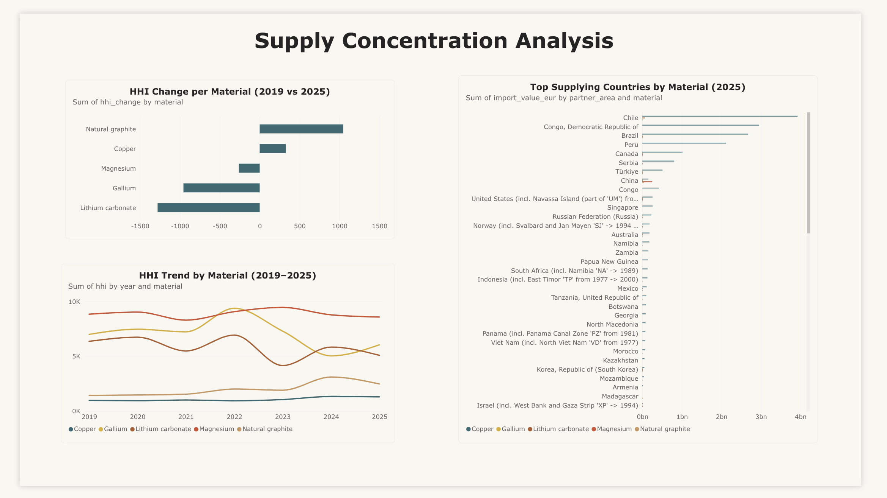
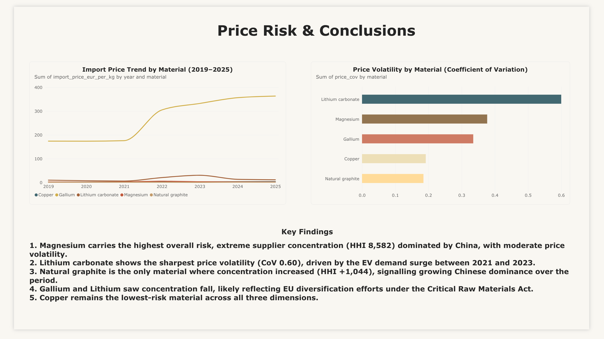

# EU Critical Raw Materials -- Supply Chain Risk Analysis (2019-2025)

## Dashboard

[View Power BI Report](dashboard/eu_crm_risk_analysis.pbix)

## What this project is about

The EU imports most of its critical raw materials from a small number of countries. 
When those supply chains are disrupted -- by export restrictions, geopolitical 
tensions, or demand shocks -- there is very little flexibility to absorb the impact.

This project examines five materials the EU has flagged as strategically critical: 
magnesium, gallium, natural graphite, lithium carbonate, and copper. Using seven 
years of Eurostat trade data, it measures how concentrated each material's supply 
base is, how that concentration changed between 2019 and 2025, how volatile import 
prices have been, and which material carries the highest combined risk.

---

## Tools used

- Python (pandas) -- data cleaning and preparation  
- MySQL -- HHI calculations and SQL analysis  
- Power BI -- dashboard  
- DBeaver -- SQL environment  
- GitHub -- version control  

Data source: Eurostat DS-045409 (EU imports by partner country, 2019-2025)  
Price data: EU Critical Raw Materials Act monitoring report (June 2026)

---

## How the analysis works

Supply concentration is measured using the **Herfindahl-Hirschman Index (HHI)** -- 
the sum of squared import share percentages per material and year. A higher HHI 
means supply is more concentrated in fewer countries.

Three dimensions are combined into a composite risk ranking:

1. **2025 HHI** -- how concentrated supply is right now  
2. **HHI change since 2019** -- whether concentration is getting better or worse  
3. **Price CoV** -- how volatile import prices have been (coefficient of variation)

Each material is ranked 1-5 on all three dimensions. The average rank gives the 
final risk score.

---

## Key findings

**Magnesium is the highest-risk material.** HHI of 8,582 in 2025, almost entirely 
supplied by China. Even with moderate price volatility, the supplier concentration 
alone makes it the most exposed.

**Lithium carbonate had the most volatile prices.** CoV of 0.60, driven by the 
EV demand surge between 2021 and 2023 and the subsequent price correction.

**Natural graphite is the only material where concentration increased.** HHI rose 
by 1,044 points between 2019 and 2025, reflecting China's growing dominance in 
processed graphite supply.

**Gallium and lithium saw concentration fall** -- likely reflecting early EU 
diversification efforts, though both remain highly concentrated.

**Copper is the lowest-risk material** across all three dimensions -- more 
geographically distributed supply and stable pricing.

---

## Project structure
eu-crm-risk-analysis/
├── README.md
├── notebooks/
│ └── phase1_data_preparation.ipynb
├── data/
│ ├── raw/ # original Eurostat files
│ ├── supplier_data.csv
│ ├── crm_prices.csv
│ ├── reconciliation.csv
│ └── all_materials_reference.csv
├── sql/
│ ├── phase2_hhi_analysis.sql
│ ├── phase3_change_and_volatility.sql
│ └── phase4_ranking.sql
├── dashboard/
│ └── eu_crm_risk_analysis.pbix
└── screenshots/
├── page1_risk_overview.png
├── page2_supply_concentration.png
└── page3_price_risk_conclusions.png

---

## Dashboard preview

**Page 1 -- Risk Overview**  

**Page 2 -- Supply Concentration**  

**Page 3 -- Price Risk and Conclusions**  

---

## Limitations

- Import shares are value-based (EUR), not volume-based. A price spike in one 
  country can inflate its apparent share even if physical volumes did not change.
- The analysis covers EU-level aggregate imports. Country-level exposure within 
  the EU varies.
- HHI measures supplier concentration, not geopolitical risk directly. A high HHI 
  with a stable partner country is different from a high HHI with a politically 
  exposed one.
